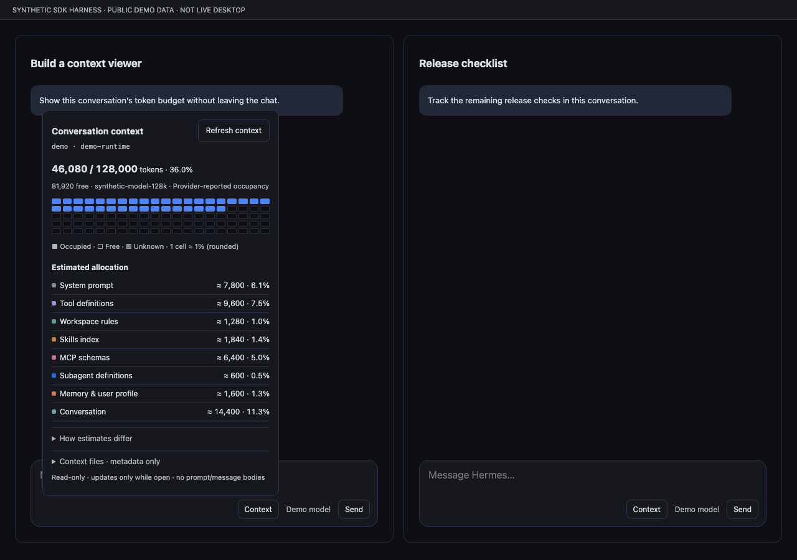

# Context Overview for Hermes Desktop

**Version 1.1.0:** a compact **Context** control beside each conversation’s composer controls. Open it to inspect that conversation’s token budget without leaving the chat. There is no sidebar page, command-palette navigation, global top box or new collector.



**Screenshot disclosure:** these are the actual plugin entry rendered in a **synthetic SDK browser harness**, not live Hermes Desktop. All conversations, identifiers, paths and budgets are public demo fixtures. [Narrow light](docs/screenshots/harness-light-390.png), [wide light](docs/screenshots/harness-light-1280.png), [narrow dark](docs/screenshots/harness-dark-390.png).

## Use

Click **Context** beside the model/send controls, or focus the button and press Enter/Space. A native SDK popover opens above that composer, with:

- Occupied / capacity tokens, percent occupied, free budget, model and occupancy provenance.
- A **100-cell** overall occupancy grid and compact estimated category list.
- Optional, initially collapsed explanations, context-file metadata and data-quality notes.
- An explicit refresh button; idle refresh every 60 seconds **only while open**.

Escape or an outside interaction dismisses it. Escape returns focus to the trigger. Moving to another conversation, changing owner/profile/connection or reconnecting closes the old popup rather than silently retargeting it. Open Context again when needed. Busy sessions show a waiting state instead of mid-turn estimates. A fresh conversation without a runtime session shows an empty state.

## Per-conversation ownership

`composer.actions` mounts the control separately in every composer. Its render callback does **not** receive a session ID, so a closed button deliberately says only **Context**: it never duplicates global focused-session numbers across all conversations.

Binding happens at user activation, after the host’s window-capture pointer/focus routing has selected the owning conversation. The instance captures the public `focusedSessionId` and connection-qualified `focusedSessionOwner`, ambient connection/profile, gateway identity and lifecycle epoch. It keeps that identity fixed until dismissal. Any identity change immediately gates content and unmounts the query; pending old-scope responses cannot paint a new conversation. Forced dismissal suppresses the old popover’s focus return so it cannot steal focus back from the newly activated composer.

RPC dispatch uses the exact `profileRoutes()` descriptor plus `requestProfile()` for a foreign owner, or `host.request()` only for the matching ambient owner. Missing/ambiguous routes or owner metadata fail closed. Busy state comes from `busyBySession[capturedSession]` when available, otherwise the focused busy atom only while captured identity still matches. Other sessions’ busy updates do not hide or refetch this popup.

This depends on the inspected Desktop tree’s existing **window-capture `pointerdown` / `focusin` ownership routing**. It does not invent session render props, import private composer hooks, scan host DOM, or patch core. The source references and the explicitly emulated host seam are recorded in [verification](docs/verification.md). Browser tests are not proof of live native integration or support for other host layouts that omit that routing.

## What the numbers mean

- **Occupied/free:** `context_used` and `context_max` from the existing metadata-only `session.context_breakdown` RPC. Provenance is provider usage, provider usage plus estimated delta, local estimate, or unknown. Free budget never comes from estimated category totals.
- **100 cells:** overall window occupancy, rounded to nearest 1%; not estimated category attribution. Over-budget pictures cap at 100% with an excess warning. Unknown occupancy is never painted as free.
- **Estimated allocation:** gateway counts and order are preserved, including zero-token rows. Percentages mean percent of the model window. Missing optional categories are not invented zeros. Row sum, reported estimate and occupancy remain separate and are never stretched to match.
- **Context files:** reported label/path, character count, token estimate, loaded flag and status only. The plugin does not open files or add file estimates to categories again.
- Raw system prompts, messages, memory contents, individual tool/skill costs and session titles are not fetched or fabricated. The existing conversation heading provides the name; the popup shows profile/runtime ID as secondary metadata.

## Requirements

`plugin.yaml` declares **Hermes >=0.22.2** as the RPC baseline, not a guarantee that every older Desktop build has the necessary SDK. The host must expose `COMPOSER_AREAS.actions`, native `Button`/`Popover*`, React Query, `focusedSessionId`, `focusedSessionOwner`, connection/profile/gateway state and the existing tree ownership routing. Foreign-owner sessions also need `profileRoutes()` / `requestProfile()`.

The implementation was checked against runtime `d923a5eb487a17c0a68801bba9ef0f56c81040a8` and the SDK reference supplied during development. Missing RPC methods show a compatibility message without retries. Transient errors and missing model windows retry twice, then stop; no stale budget is presented. There is no legacy active-session fallback without focused ownership.

## Install / enable / remove

Source validation does not install the plugin or establish that Desktop loaded it. For a standalone disk installation, place `desktop/plugin.js` at:

```text
$HERMES_HOME/desktop-plugins/hermes-context-overview/plugin.js
```

The directory must match the plugin ID. The standalone entry defaults enabled while respecting an explicit disabled choice. Check **Context Overview** in Desktop’s Plugins UI; use **Reload desktop plugins** if necessary. Unified package installation is also supported by Hermes’s plugin installer. For a package-managed copy, use Desktop **Rescan** to synchronize the package source, then enable its Desktop half if needed. No Python backend is included or needs enabling. No restart is required by this plugin.

To roll back, disable the plugin and remove/uninstall it through its owning installation mechanism. It writes no session data, settings, files or plugin storage. Do not remove a package-managed app-root copy while leaving its source installed.

## Read-only / privacy boundary

Production imports only `@hermes/plugin-sdk`, `react` and `react/jsx-runtime`. The only RPC is `session.context_breakdown`, with only `session_id`. There are no filesystem/config/credential reads, transcript requests, vendor calls, inference, tools, telemetry, navigation or global DOM patches. Paths/labels returned by the gateway may still be sensitive metadata; they remain local and are not exported or used in test fixtures/logs/screenshots.

Queries and event listeners exist only while a popup is open. Explicit refresh, completion/compression/reclaim events and idle polling are scoped to its captured identity. Closing, unmounting or disabling removes observers/listeners; gateway/profile/connection changes invalidate pending snapshots.

## Development and evidence

```sh
pnpm install --frozen-lockfile --ignore-scripts
pnpm exec playwright install chromium
node --check desktop/plugin.js
pnpm test
hermes plugins doctor --ci .
hermes plugins validate . --install-deps
```

Dev dependencies only; production is plain ESM with no build step. Browser tests mount the actual registered contribution in **two simultaneous synthetic conversation composers** using real React/React Query and **Radix UI 1.6.7**, the inspected host’s popover primitive/version. Gateway state, focus routing, contribution registry and Button/native wrapper styling remain explicit seams. Tests cover pointer/keyboard ownership, exact owner RPC routing, different budgets, stale-result isolation, lifecycle/retry/privacy behavior and four public screenshots.

`node scripts/verify.mjs` retains command logs and candidate hashes under ignored `.local/`. The known doctor `No __init__.py` failure is reported as a Desktop-only tooling limitation, not hidden with a dummy Python shim. See [verification](docs/verification.md) for results and limits. No live native renderer, connected gateway, catalog approval or publication is claimed.

Core’s global statusbar popover and CLI collector plugins address different surfaces. This package adds an in-conversation inspector by reusing the existing RPC, not by forking core or adding a collector.

MIT · AsoTora. Theme-token provenance: `tests/harness-theme.css` and `LICENSE`.
